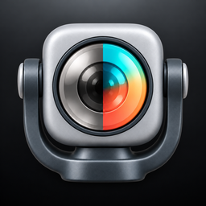

# DJI LogLift

A native macOS app for batch conversion of DJI Log footage to Rec.709. Video processing runs locally.

**Source-available for noncommercial purposes under PolyForm Noncommercial 1.0.0.** See [LICENSING.md](LICENSING.md) for permitted uses, commercial licensing, and the earlier MIT snapshot.



## Features

- Choose a camera and recording profile from a product gallery.
- Apply supported official 3D technical Log-to-Rec.709 LUTs.
- Compare original and converted video with synchronized playback.
- Import multiple clips and export HEVC Main10 video.
- Keep source resolution, timestamps, display transform, and supported compressed audio.
- Remember the export folder and report batch completion.
- Use English, Simplified Chinese, Japanese, or Korean.

Exports use new files and do not replace an existing destination. Failed and cancelled jobs remove their temporary output. Motion respects the system Reduce Motion preference.

## Requirements

- macOS 14 or later.
- Xcode with the macOS 26 SDK or later for building the Liquid Glass code paths.
- XcodeGen.
- FFmpeg and FFprobe for the verification suite; neither is a runtime dependency.

## Build and run

The Xcode project and scheme are named `LogBatch`. The app bundle is `LogLift for DJI.app`, and its executable is `LogLift`.

```sh
./script/build_and_run.sh --build-only
```

The script generates the Xcode project and builds without launching the app. It uses `~/Library/Caches/LogBatch/DerivedData` by default. Set `LOGBATCH_DERIVED_DATA` to use a different build cache.

To build and open the app:

```sh
./script/build_and_run.sh --verify --foreground
```

The build script disables code signing for local development. Version tags trigger Developer ID signing, notarization, and GitHub preview releases. See [Tag releases](docs/RELEASING.md) for setup, version rules, and recovery. App Store distribution is not configured.

## Verify

Run the Python importer tests and verify the pinned resource bytes without network access:

```sh
python3 -m unittest discover -s Tests -p 'test_*.py'
python3 script/sync_dji_luts.py
python3 script/sync_product_images.py
```

The full suite uses the shared `task-artifacts` command to isolate synthetic clips, logs, and XCTest results:

```sh
task-artifacts start --repo "$PWD" --label loglift-verification
task-artifacts run <task-id> -- ./script/verify.sh
```

The command is an optional external developer tool from [ajigu-skills](https://github.com/huihuisang/ajigu-skills). To run the suite without that tool, choose a new directory outside the checkout for disposable outputs:

```sh
TASK_ARTIFACT_DIR="$(mktemp -d "${TMPDIR:-/tmp}/loglift-verification.XXXXXX")" ./script/verify.sh
```

The suite builds the app, runs hostless Swift tests, and checks synthetic encoded media with FFprobe. It does not launch the main app.

## Included DJI resources

The pinned 2026-10-30 snapshot contains 44 LUT packages, 64 CUBE files, and 36 product-image entries. The files are included unchanged, with their source URLs, versions, and SHA-256 checksums.

- `LogBatch/Resources/DJI/catalog.json`: runtime LUT catalog and provenance.
- `LogBatch/Resources/DJI/LUTs/`: original CUBE files.
- `LogBatch/Resources/ProductImages/`: official photos and their manifest.
- `vendor/dji/`: source-index snapshot, original ZIP archives, and provenance notice.

**The DJI resources are excluded from the project license. Permission to redistribute them has not been verified.** Their presence in this public repository does not establish a redistribution license. Read [THIRD_PARTY_NOTICES.md](THIRD_PARTY_NOTICES.md) and [vendor/dji/NOTICE.md](vendor/dji/NOTICE.md) before reuse or distribution.

The optional `--download` importer commands fetch official resources and refuse to replace an existing catalog. They are not needed to build this snapshot. Resource updates must preserve source bytes and provenance.

## Limits

- Select the camera and recording profile explicitly. A filename, flat appearance, or Rec.709 container tag does not prove Log encoding.
- Only supported 3D technical Log-to-Rec.709 transforms are enabled. Creative LUTs, 1D tables, Linear-to-Log, sRGB, and HDR transforms remain archived resources.
- Inputs support one video track and at most one audio track. HLG and PQ inputs are rejected. Unsupported combinations fail instead of discarding source content.
- Export is a lossy re-encode. Ten-bit output does not increase an eight-bit source's precision.
- Auxiliary camera, gyro, and timecode metadata are not copied into exports.
- Synthetic tests do not establish color accuracy for every camera. Long 4K batches and the final signed sandbox build need additional acceptance tests.

## License and affiliation

Original project code and project-created artwork are offered under [PolyForm Noncommercial 1.0.0](LICENSE), subject to [LICENSING.md](LICENSING.md) and the exclusions in [THIRD_PARTY_NOTICES.md](THIRD_PARTY_NOTICES.md). Commercial purposes outside the license's permissions require a separate grant. The previously published MIT snapshot retains its valid earlier permissions, including commercial use. No license is granted to DJI materials or trademarks.

This is an independent project, not an official or endorsed DJI product. It is a local development build, not an approved App Store release.
